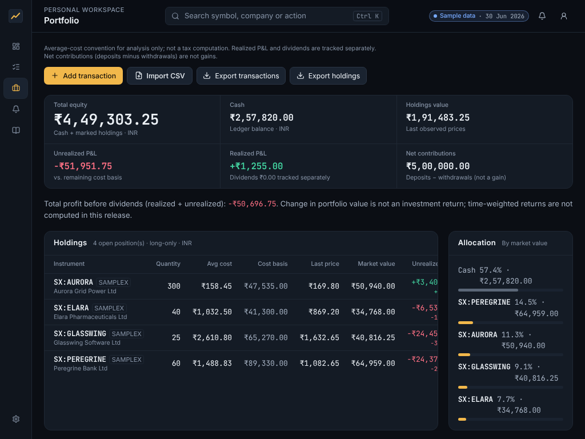

# MarketDesk

A personal market research terminal for Indian equities: watchlists, instrument charts and fundamentals, an INR
portfolio ledger with CSV import/export, sampled price alerts, an investment journal and a rule-based morning
briefing. It runs as one FastAPI process (API + built React SPA on the same origin) plus one alert worker, on SQLite.

It is a research and record-keeping tool. It does not place orders, connect to a broker, or make recommendations.
No paid or LLM APIs are used.


| Instrument detail | Portfolio | Phone |
| --- | --- | --- |
|  |  |  |

All screenshots use the **fictitious sample dataset** (`SX:` symbols on an imaginary exchange). More views, including
the light theme, dialogs and error/empty states, are in [`docs/screenshots`](docs/screenshots).

## Data modes

| `DATA_PROVIDER` | What you see | Network |
| --- | --- | --- |
| `fixture` (default) | Deterministic synthetic data for fictitious companies, fixed at **30 Jun 2026**, with a persistent "Sample data" badge. Prices are never presented as live and timestamps never move to the present. | none |
| `yahoo` | Live Yahoo Finance data through the unofficial [yfinance](https://ranaroussi.github.io/yfinance/) library (1.7.0). | Yahoo |

The app never silently falls back from Yahoo to fixtures. Every value carries its source, market time, fetch time,
currency, timezone and a freshness status (`sample`, `available`, `cached`, `stale`, `missing`, `unsupported`,
`unavailable`). Missing data is shown as an explained em dash, never as zero. When Yahoo fails, the last successful
result is shown marked **stale**. Market open/closed status is shown as unavailable because no verified NSE
holiday calendar is bundled.

**Data rights.** yfinance is not affiliated with Yahoo. Yahoo data is intended for personal use; read the yfinance
documentation and Yahoo's terms before redistributing anything. Do not expose a Yahoo-mode instance publicly. The
optional public showcase (`PUBLIC_DEMO=true`) only runs in fixture mode, and the server rejects every write.

## Quick start (local development)

Requirements: Python 3.13 with [uv](https://docs.astral.sh/uv/) 0.11, Node.js 22.

```bash
cd apps/api && uv sync && uv run marketdesk migrate
```

```bash
cd apps/api && DEV_AUTH_BYPASS=true uv run uvicorn marketdesk.main:app --reload --port 8000
```

```bash
cd apps/api && DEV_AUTH_BYPASS=true ALERT_POLL_SECONDS=10 uv run python -m marketdesk.worker
```

```bash
cd apps/web && npm ci && npm run dev
```

Open http://localhost:5173 (Vite proxies `/api` to port 8000). `DEV_AUTH_BYPASS` skips login and is refused unless
`MARKETDESK_ENV=development` (the default outside Docker). The database lives in `./data/marketdesk.db`.

Start from an empty workspace, or load fictitious sample content explicitly: **Load sample starter** on the Overview,
**Load sample portfolio** on an empty Portfolio page, or `uv run marketdesk seed-demo` (fixture mode only; it never
overwrites existing data). MarketDesk never invents holdings in your account.

For live data, add `DATA_PROVIDER=yahoo` to the API and worker commands. **Load NSE starter** then adds a few real
NSE symbols (listed in `config/starter_watchlist.yahoo.json`).

## Production with Docker Compose

Requirements: a host that can run a long-lived Python web process **and** a worker process with a persistent disk.
Static-only hosts cannot run the backend, and sleeping or free tiers cannot evaluate alerts continuously.

1. Create `.env` from the example and set owner credentials:
   ```bash
   cp .env.example .env
   ```
   ```bash
   docker compose build
   ```
   ```bash
   docker compose run --rm --no-deps web python -m marketdesk.cli hash-password
   ```
   Paste the printed hash into `.env` as `OWNER_PASSWORD_HASH='…'` (keep the single quotes), set `OWNER_USERNAME`,
   and set `SESSION_SECRET` to at least 32 random characters
   (`python3 -c "import secrets; print(secrets.token_urlsafe(48))"`). Set `DATA_PROVIDER=yahoo` for live data.
2. Start:
   ```bash
   docker compose up -d
   ```
   `migrate` runs once and exits, then `web` (port 8000 on 127.0.0.1) and `worker` start. Both have health checks.
   Production refuses to start if credentials or the session secret are missing.
3. Put HTTPS in front. Example Caddyfile:
   ```
   desk.example.com {
       reverse_proxy 127.0.0.1:8000
   }
   ```
   Cookies are `Secure` in production; keep `COOKIE_SECURE=true` behind HTTPS. Uvicorn runs with
   `--proxy-headers`. Same-origin needs no CORS; only list extra origins in `ALLOWED_ORIGINS`.

If Docker Hub rate-limits image pulls, set `PYTHON_IMAGE=mirror.gcr.io/library/python:3.13-slim` and
`NODE_IMAGE=mirror.gcr.io/library/node:22-slim` in `.env`. Behind a TLS-intercepting proxy, build with
`docker build --secret id=ca_bundle,src=/path/to/ca.crt .`.

This repository is **deployment-ready, not deployed**: no hosting account was used, and no public URL exists.

### Operations

| Task | Command |
| --- | --- |
| Back up (consistent, online; includes WAL) | `docker compose exec web python -m marketdesk.cli backup /data/backups/md-$(date +%F).db` |
| Copy a backup out | `docker compose cp web:/data/backups/md-2026-11-03.db ./` |
| Restore (stop services first) | `docker compose stop web worker` then `docker compose run --rm --no-deps web python -m marketdesk.cli restore /data/backups/FILE.db --yes` then `docker compose start web worker` |
| Rotate the owner password | generate a new hash, update `.env`, `docker compose up -d` |
| Sign out every session | rotate `SESSION_SECRET`, or `docker compose exec web python -m marketdesk.cli revoke-sessions` |
| Worker health | `docker compose exec worker python -m marketdesk.cli worker-health` |

Backups use SQLite's backup API, so they are consistent while the app runs. Never copy a live `.db` file without its
`-wal` file. A restore brings back watchlists, transactions, alerts, journal notes and settings (covered by
`apps/api/tests/test_backup.py`).

## Accounting rules

The INR ledger supports DEPOSIT, WITHDRAWAL, BUY, SELL, DIVIDEND and explicitly confirmed SPLIT, long-only.
Decimal arithmetic throughout; amounts settle to paise; average cost keeps full precision and is rounded only for
display. Buy cost = qty × price + fees; a sell releases qty × average cost; realized P&L = proceeds − fees − released
basis; splits change quantity, not basis. Every edit replays the whole ledger and is rejected if cash would go
negative or a sale would exceed holdings at any point. Average cost is an analytical convention, not a tax report.
Net deposits are not shown as gains, and returns (XIRR/TWR) are deliberately not computed in this release.

The specification's example (deposit 10,000; buy 10 @ 100 + 10; buy 10 @ 120 + 10; sell 5 @ 130 + 5; mark 140;
2-for-1 split) is an automated test: average 111, basis 2,220 → realized 90, cash 8,425, equity 10,525, profit 525,
then 30 shares at 55.50.

CSV import uses the canonical columns `date,type,symbol,quantity,price,fees,amount,currency,split_from,split_to,notes`
(a template is downloadable in the import dialog). Imports are previewed row by row, all-or-nothing, and duplicate rows
are skipped. Exports neutralise spreadsheet formulas.

## Alerts

Alerts are **sampled**: the worker polls quotes every `ALERT_POLL_SECONDS` (default 300) and fires once on the first
observed match, then waits to be rearmed. Observations are keyed by market timestamp and events by
`alert:arm`, so cached re-reads and worker restarts cannot duplicate events. Stale or failed quotes are never evaluated.
Only in-app notifications exist; email, Telegram and push are not configured. Alerts require the server and worker to
be running.

In fixture mode, **Advance sample session** (Alerts or Settings page) steps the fixed dataset to its next session, a
deterministic way to watch an alert fire. **Simulate provider outage** (Settings) exercises the stale-data path.

## Tests

| Suite | Command | Result on 2026-11-03 |
| --- | --- | --- |
| API (pytest: ledger, CSV, alerts, auth, cache/circuit, providers, backup) | `cd apps/api && uv run pytest` | 64 passed |
| API lint | `cd apps/api && uv run ruff check marketdesk tests` | clean |
| Web types / lint | `cd apps/web && npx tsc -b --noEmit && npx eslint .` | clean |
| Web unit (Vitest) | `cd apps/web && npx vitest run` | 19 passed |
| Browser journeys (Playwright, real API + worker, fixture mode) | `cd apps/web && npm run build`, then `cd tests/e2e && npm ci && npx playwright test` | 10 passed |
| Review screenshots | `cd tests/e2e && npm run screenshots` | written to `docs/screenshots` |
| Live Yahoo smoke test | `cd apps/api && uv run python ../../scripts/check_yahoo.py` | passed (see `docs/STATUS.md`) |

CI (`.github/workflows/ci.yml`) runs the API, web and browser suites in fixture mode and builds the Docker image; it
never depends on Yahoo.

API types for the frontend are generated from FastAPI's OpenAPI schema: `cd apps/web && npm run gen:api`.

## Layout

```
apps/api     FastAPI app (marketdesk/), Alembic migrations, pytest suite
apps/web     React + TypeScript SPA (src/app, components, features, lib, styles), Vitest
tests/e2e    Playwright journeys and screenshot capture
fixtures     Committed synthetic dataset (regenerate: python scripts/generate_fixtures.py)
config       Starter watchlist for Yahoo mode
docs         PLAN, STATUS, DECISIONS, screenshots
```

## Runtime versions

Python 3.13 · FastAPI 0.162.0 · Uvicorn 0.54.0 · SQLAlchemy 2.1.6 · Alembic 1.20.1 · Pydantic 2.14.2 · yfinance 1.7.0 ·
pandas 3.1.0 · argon2-cffi 25.1.0 · Node 22 · React 19.3.1 · Vite 7.3.7 · TypeScript 5.9.3 · Tailwind CSS 4.3.4 ·
TanStack Query 5.105.3 · React Router 7.18.5 · React Hook Form 7.91.0 · Zod 4.6.7 · Lightweight Charts 5.2.1 ·
Vitest 3.2.7 · Playwright 1.63.0. Exact pins are in `apps/api/uv.lock` and the `package-lock.json` files.

## Attribution

- Charts: [TradingView Lightweight Charts™](https://www.tradingview.com/lightweight-charts/) (Apache-2.0), Copyright ©
  TradingView, Inc. Each chart shows the TradingView attribution logo; the About section in Settings repeats it.
- Live data: Yahoo Finance via [yfinance](https://github.com/ranaroussi/yfinance) (Apache-2.0, unofficial).
- Fonts: Inter and JetBrains Mono (SIL OFL 1.1) bundled through Fontsource. Icons: Lucide (ISC).

No licence has been chosen for MarketDesk's own code; add one before distributing it.

## Known limitations

See `docs/STATUS.md` for the current list. In short: alerts are sampled, not tick-by-tick; market open/closed status
is not shown; portfolio is INR-only and long-only; no XIRR/TWR or historical equity chart; Yahoo coverage and field
availability vary (fields are shown as missing rather than guessed).
