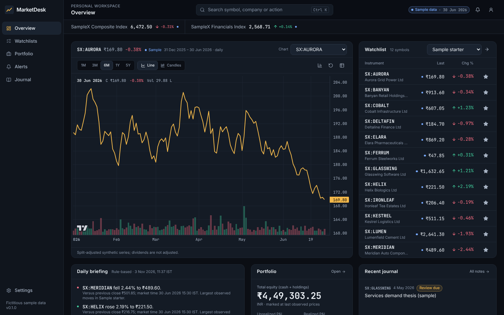
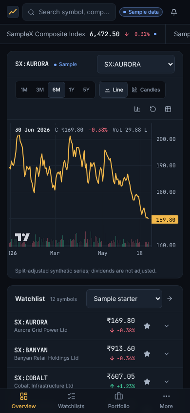

# MarketDesk

A personal market research terminal for Indian and US listings, built on **real market data** from Yahoo Finance:
watchlists, instrument charts and fundamentals, INR and USD portfolio accounts with FX conversions and CSV import/export,
sampled alerts (price,
crossing, volume, volatility, SEC filings) with an inbox, a versioned decision journal and rule-based briefings. It runs as a
FastAPI web process (API + built React SPA on the same origin) plus one alert worker, on SQLite or PostgreSQL.

It is a research and record-keeping tool. It does not place orders, connect to a broker, or make recommendations.
No paid or LLM APIs are used.



| Instrument detail | Phone |
| --- | --- |
|  |  |

Screenshots were captured on 3 Nov 2026 from Yahoo Finance via yfinance; the prices shown are from that moment.
The portfolio starts empty: MarketDesk never invents holdings.

## Real data only

The app shows Yahoo Finance data through the unofficial [yfinance](https://ranaroussi.github.io/yfinance/) library
(1.7.0). Every value carries its source, market time, fetch time, currency, timezone and a freshness status
(`available`, `cached`, `stale`, `missing`, `unsupported`, `unavailable`). Missing data is shown as an explained em
dash, never as zero. When Yahoo fails, the last successful result is shown marked **stale**, and alerts are not
evaluated on it. Market open/closed status is shown as unavailable because no verified NSE holiday calendar is
bundled.

The repository also contains a deterministic synthetic dataset (`fixtures/`, `DATA_PROVIDER=fixture`). It exists only
so the automated tests and CI are reproducible without the internet. The server **refuses to start with it in
production**, and it never appears in a deployed site.

**Data rights.** yfinance is not affiliated with Yahoo. Yahoo data is intended for personal use; read the yfinance
documentation and Yahoo's terms before redistributing anything. Keep your instance private (owner login is mandatory
in production). Note that Yahoo rate-limits some cloud IP ranges; MarketDesk then shows stale/unavailable states
rather than wrong numbers.

## Deploy

The host must run the web process **and** the alert worker, and the data must live somewhere persistent: either a
disk/volume for SQLite at `/data`, or an external PostgreSQL database via `DATABASE_URL`. Static hosts cannot run the
backend, and sleeping free tiers cannot evaluate alerts continuously. Every route below needs three secrets:

- `OWNER_USERNAME` — your login name.
- `OWNER_PASSWORD_HASH` — an argon2 hash, created with the command below; you type the password, it is never stored.
- `SESSION_SECRET` — 32+ random characters (`python3 -c "import secrets; print(secrets.token_urlsafe(48))"`).

From a checkout of this repository:

```bash
cd apps/api && uv sync && uv run marketdesk hash-password
```

or with plain Python 3 (prompts for the password without echoing it):

```bash
python3 -m pip install argon2-cffi==25.1.0 && python3 -c "import getpass; from argon2 import PasswordHasher; print(PasswordHasher().hash(getpass.getpass('Owner password: ')))"
```

### Option A — Render Free + Neon Postgres (no cost)

Render's Free plan has no persistent disk: its filesystem is wiped on every restart, redeploy and spin-down. So the
data lives in a free external PostgreSQL database instead (Neon's free plan needs no credit card). Sign-ins are signed
cookies and survive restarts on their own.

1. **Database:** sign up at [neon.tech](https://neon.tech) → create a project (region: *Asia Pacific (Singapore)* is
   closest to Render Singapore) → copy the connection string (`postgresql://…?sslmode=require`).
2. **App:** Render dashboard → **New** → **Blueprint** → this repository, branch `main` (`render.yaml` selects the
   Free plan, Singapore). Enter `OWNER_USERNAME`, `OWNER_PASSWORD_HASH` (exactly as printed, no quotes) and
   `DATABASE_URL` (the Neon string). `SESSION_SECRET` is generated. For an existing service instead: Settings →
   Instance type **Free**, Environment → add `DATABASE_URL`, and remove any custom start command.
3. Open `https://<service>.onrender.com`, sign in, and check **Settings → Data status → Storage**: it should say
   *external PostgreSQL database*. The Overview shows a warning if data is not persistent.
4. Check **Settings → Data status → Database round trip**. Same-region hosting answers in a few milliseconds; around
   100 ms or more means the web service and the database are in different regions, and every page waits for several
   round trips. Both regions are fixed when created: create the Render service in **Singapore** to match a Neon
   project in *AWS Asia Pacific (Singapore)* (or the other way round).

#### Render reference (names the code actually reads)
| Variable | Required | Notes |
| --- | --- | --- |
| `OWNER_USERNAME` | yes | Your sign-in name. Surrounding spaces/newlines are ignored. |
| `OWNER_PASSWORD_HASH` | yes | Output of `marketdesk hash-password`, pasted **without quotes**. Startup refuses a quoted, `$$`-escaped, cut-off or non-argon2 value and says which. |
| `SESSION_SECRET` | yes | ≥ 32 random characters (the Blueprint generates it). Changing it signs every browser out. |
| `DATABASE_URL` | yes on Render Free | The Neon connection string (`postgres://` or `postgresql://`, keep `?sslmode=require`). |
| `MARKETDESK_ENV` | set by the Blueprint | `production` (secure cookies, startup checks, no API docs). |
| `DATA_PROVIDER` | no | Defaults to `yahoo`. |
| `ALERT_POLL_SECONDS`, `WORKER_START_DELAY_SECONDS`, `WORKER_NICE` | no | Worker sampling interval (300 s) and start-up pacing. |
| `SEC_USER_AGENT` | for US filings | Application name and **your** contact email (SEC fair-access rule), e.g. `MarketDesk you@example.com`. Without it the Financials/Filings/Events tabs explain that SEC data is off. |
| `SEC_MAX_REQUESTS_PER_SECOND`, `RESEARCH_REFRESH_HOURS` | no | SEC request budget (default 5/s; SEC allows 10) and the daily re-check interval. |
| `GROK_API` (or `GROQ_API_KEY` / `XAI_API_KEY`) | for AI research | A Groq key (`gsk_…`, free tier) or an xAI key (`xai-…`, paid); server-side only. The prefix picks the provider (`AI_PROVIDER=groq|xai` overrides). Without a key the "Ask AI" panel explains that AI is off; nothing else changes. |
| `AI_MODEL`, `GROK_ENABLED`, `AI_DAILY_TOKENS`, `AI_REQUEST_TOKENS`, `AI_DAILY_BUDGET_USD`, `AI_DAILY_REQUESTS`, `AI_MAX_OUTPUT_TOKENS`, `AI_MAX_TOOL_CALLS`, `AI_REUSE_HOURS` | no | Model (defaults `openai/gpt-oss-120b` on Groq, `grok-4.3` on xAI), off switch, and limits: Groq 150,000 tokens/day and 7,300 per request; xAI $0.50/day and 3 filing lookups; 30 answers/day, 1,800 output tokens, 24 h reuse. |

- **Start command:** none — the image's default `python -m marketdesk.serve` runs the web server and, 45 s after it
  answers, the alert worker in the same container. Leave Render's *Start Command* empty.
- **Migrations:** applied automatically when the web server (and the worker) start, serialised by a lock; no separate
  step. Manual equivalent: `python -m marketdesk.cli migrate`. **Settings → Data status → Database schema** shows the
  current and expected revision.
- **Health checks:** `/api/health` (process up) and `/api/readiness` (database reachable and migrated). Neither
  reveals configuration.
- **A separate worker service** (Compose `worker`, or a second host process) needs only the database settings
  (`DATABASE_URL` or `DATA_DIR`), `DATA_PROVIDER`, provider tuning and `ALERT_POLL_SECONDS`. It does not need
  `OWNER_*` or `SESSION_SECRET`; its start-up check skips them.
- **Diagnosing sign-in:** every response carries an `X-Request-ID`. A server failure shows *"The server could not
  complete sign-in … Reference: …"*; search Render's logs for that reference (`request_id=…`) to find the matching
  line with the exception type. Wrong credentials show *Incorrect username or password* (HTTP 401) and are logged as
  `sign-in failed: invalid credentials` without the username or password; five failures from one client lock it for
  15 minutes (HTTP 429). A page saying the server is *starting or temporarily unavailable* comes from Render while the
  instance wakes or redeploys.
- **Backups:** **Settings → Export and backup → Full backup (JSON)** downloads a consistent snapshot (see Operations).

Free-tier trade-offs (Render docs, Nov 2026): the service sleeps after 15 minutes without visits and takes about a
minute to wake; **price alerts are only evaluated while it is awake**; 750 free instance hours per month. Neon's free
compute also suspends when idle and wakes on the next query. Render's own free Postgres is deleted after 30 days, so
it is not suitable.

### Option B — Any Linux server with Docker Compose

```bash
git clone https://github.com/its-harsh-here/MarketDesk.git && cd MarketDesk && cp .env.example .env
```
```bash
docker compose build && docker compose run --rm --no-deps web python -m marketdesk.cli hash-password
```

Put the hash in `.env` as `OWNER_PASSWORD_HASH='…'` (keep the single quotes), set `OWNER_USERNAME` and
`SESSION_SECRET`, then:

```bash
docker compose up -d
```

`migrate` runs once and exits; `web` (127.0.0.1:8000) and `worker` start with health checks. Put HTTPS in front, for
example with Caddy (`desk.example.com { reverse_proxy 127.0.0.1:8000 }`). Cookies are `Secure` in production.

If Docker Hub rate-limits pulls, set `PYTHON_IMAGE=mirror.gcr.io/library/python:3.13-slim` and
`NODE_IMAGE=mirror.gcr.io/library/node:22-slim` in `.env`. Behind a TLS-intercepting proxy, build with
`docker build --secret id=ca_bundle,src=/path/to/ca.crt .`.

### Container notes

- The image's entrypoint makes `/data` writable (platform disks are mounted root-owned) and drops to the unprivileged
  `marketdesk` user; no MarketDesk process runs as root. CLI commands run through `docker compose exec` also switch
  to that user automatically.
- Default command: `python -m marketdesk.serve` — supervises web + worker in one container (Render, Fly.io, a single
  VM), listening on `$PORT`. The web server starts first (it migrates the database and answers as soon as it can);
  the alert worker starts `WORKER_START_DELAY_SECONDS` (default 45) after the site is up, at lower CPU priority
  (`WORKER_NICE`, default 10), so a 0.1-CPU free instance serves pages first. Compose runs migrate, web and worker
  separately.
- Every `/api` response carries a `Server-Timing` header (application time, database time and statement count),
  visible in the browser's network panel, for diagnosing slow pages. It contains durations only.
- Storage: SQLite at `DATA_DIR` (needs a persistent mount) or PostgreSQL via `DATABASE_URL` (`postgres://` URLs are
  accepted as given). Both are covered by the test suite and CI.
- Production refuses to start if credentials or the session secret are missing, or if `DATA_PROVIDER=fixture`.

### Operations

| Task | Command (Compose; on Render use the service Shell without `docker compose exec web`) |
| --- | --- |
| Back up (consistent, online; includes WAL) | `docker compose exec web python -m marketdesk.cli backup /data/backups/md-$(date +%F).db` |
| Restore (stop services first) | `docker compose stop web worker` then `docker compose run --rm --no-deps web python -m marketdesk.cli restore /data/backups/FILE.db --yes` then `docker compose start web worker` |
| Rotate the owner password | generate a new hash, update the secret, restart |
| Sign out every session | rotate `SESSION_SECRET`, or `python -m marketdesk.cli revoke-sessions` |
| Worker health | `python -m marketdesk.cli worker-health` |

**Database-agnostic backups (SQLite or PostgreSQL, works on Render Free without a shell):**
- Download: **Settings → Export and backup → Full backup (JSON)**, or `python -m marketdesk.cli export-data FILE.json`.
  It is one consistent snapshot of settings, instruments, watchlists, ledger transactions and import batches, alerts
  with their observations, events and deliveries, stored briefings, and the journal with its versions and reviews (caches, login attempts and worker heartbeats are left out).
  The file is private; it carries a SHA-256 checksum and the schema revision.
- Restore into an **empty** database (for example a new Neon branch/database or a fresh SQLite file), from any
  machine with the repository: `cd apps/api && DATABASE_URL='postgresql://…new-db…' uv run marketdesk import-data FILE.json --yes`.
  It migrates the target first, refuses a database that already holds data, a modified file, or a different schema
  revision, and inserts everything in one transaction. Then point `DATABASE_URL` on Render at the restored database.
  Verified by `tests/test_m00.py` (SQLite → SQLite and SQLite → PostgreSQL round trips with identical checksums).

Backups use SQLite's backup API, so they are consistent while the app runs. Never copy a live `.db` file without its
`-wal` file. A restore brings back watchlists, transactions, alerts, journal notes and settings. With PostgreSQL, use
your provider's backups (Neon keeps point-in-time history) or `pg_dump`; the CSV exports work with either.

## Local development

Requirements: Python 3.13 with [uv](https://docs.astral.sh/uv/) 0.11, Node.js 22, internet access to Yahoo.

```bash
cd apps/api && uv sync && uv run marketdesk migrate
```
```bash
cd apps/api && DEV_AUTH_BYPASS=true uv run uvicorn marketdesk.main:app --reload --port 8000
```
```bash
cd apps/api && DEV_AUTH_BYPASS=true ALERT_POLL_SECONDS=60 uv run python -m marketdesk.worker
```
```bash
cd apps/web && npm ci && npm run dev
```

Open http://localhost:5173. `DEV_AUTH_BYPASS` skips login and is refused unless `MARKETDESK_ENV=development` (the
default outside Docker). **Load NSE starter** adds the real NSE symbols listed in
`config/starter_watchlist.yahoo.json`; prices are fetched live.

## Markets

India (NSE, BSE) and US (NYSE, Nasdaq, NYSE Arca, Cboe BZX) listings can be searched (with an All/India/US filter),
charted, compared (up to three, rebased to 100 on common trading dates, own-currency price returns without
dividends) and kept in mixed watchlists. Each listing keeps its own currency and exchange; INFY.NS and the INFY ADR
are different instruments. Market session states (open, closed with the reason, or unknown) come from the
`exchange_calendars` package's published calendars, so holidays, early closes and US daylight-saving changes are
respected; dates beyond the calendar's data (India: after 2026-12-31) and special sessions such as Muhurat trading are
shown as unknown. Session states describe the exchange schedule only; quotes keep their own market time and freshness.

## Company research

Instrument Detail has Overview, Financials, Filings and Events tabs. For US registrants (matched to a CIK through
SEC's ticker file) MarketDesk reads SEC EDGAR submissions and XBRL company facts server-side, normalizes annual and
quarterly statements (each value links to its filing and keeps its tag, unit, period, form and accession; restated
values are marked; year-to-date values are not mixed with quarters), and computes margins, leverage, ROE, P/E and free
cash flow with their formulas. Banks and insurers do not get industrial lines such as revenue. Non-US listings show
that SEC data does not apply. Requires `SEC_USER_AGENT`; data is cached and re-checked daily by the worker.

## Accounting rules

The portfolio has two accounts, **INR** and **USD**, each a separate ledger with its own cash, holdings and P&L in its
own currency. An instrument must trade in its account's currency (US stocks/ETFs in USD, NSE/BSE listings in INR);
amounts are never converted or relabeled. Each account supports DEPOSIT, WITHDRAWAL, BUY, SELL, DIVIDEND and explicitly
confirmed SPLIT, long-only. Money moves between accounts only through an explicit **FX conversion**, which records the
amount paid, the amount received, conversion fees (in the paying currency), the quoted USD/INR rate (INR per USD,
optional and checked against the amounts), the rate's source and its time. Conversions are transfers, not deposits.

Decimal arithmetic throughout; amounts settle to 2 decimals; average cost keeps full precision and is rounded only for
display. Buy cost = qty × price + fees; a sell releases qty × average cost; realized P&L = proceeds − fees − released
basis; splits change quantity, not basis. Every edit replays both accounts and is rejected if either account's cash
would go negative or a sale would exceed holdings at any point. Average cost is an analytical convention, not a tax
report. Net deposits are not shown as gains, and returns (XIRR/TWR) are deliberately not computed in this release.

**All accounts** shows each account's value in its own currency and, for display only, in INR at the current valuation
rate (with its pair, source, market time and status). Without a usable rate, or with an unpriced holding, the
consolidated total is withheld and the reason is shown. No historical rate is applied, so no consolidated profit or
return is shown, and a displayed conversion never changes a transaction.

CSV import uses the canonical columns
`date,type,symbol,quantity,price,fees,amount,currency,split_from,split_to,counter_currency,counter_amount,fx_rate,fx_source,fx_time,notes`
(`currency` is the account; the five FX columns apply to FX rows only; files without them still import). A template is
downloadable in the import dialog. Imports are previewed row by row, all-or-nothing, and duplicate rows are skipped.
Exports neutralise spreadsheet formulas; holdings export per account.

## Decision journal

A note links one instrument to a dated thesis, risks, invalidation conditions, your decision (watch, buy, add, hold,
trim, sell or avoid — your record, not a recommendation), conviction (1–5), horizon, tags and a review date.
- **Versions:** the first save is version 1. An edit that changes the thesis must say what changed and why, and becomes a
  new version; earlier versions are never modified. Tags and the review date can change without a new version, and a
  note's instrument cannot change.
- **Evidence:** each version stores what the data showed when it was saved — price with market time and status, P/E,
  dividend yield and market cap, and recent SEC filings for US listings. The Evidence view puts any version's snapshot
  beside today's data (fetched for comparison, never saved over the snapshot): price change in the instrument's
  currency, filings since, and a warning when a split makes the raw price comparison meaningless.
- **Reviews:** notes whose review date has arrived appear in the review queue. Completing a review records an outcome
  (intact, weakened, invalidated, closed), your notes, the evidence at that moment and the next review date.
- Notes are plain text, written by you; nothing is generated. Deleting a note (with confirmation) deletes its history.

## AI research (optional)

On Instrument Detail, **Ask AI** runs one of four tasks: latest results, possible catalysts, a comparison with one or
two other listings, or your own question. Two providers are supported, chosen from the key in `GROK_API`:
**Groq's free tier** (a `gsk_` key; default model `openai/gpt-oss-120b`) or **xAI Grok** (an `xai-` key, paid; default
`grok-4.3`).
- **Evidence first:** MarketDesk retrieves and computes the evidence itself — quote, one-year price statistics,
  fundamentals, and for US registrants SEC statements (with period changes and ratios computed in code), the filing list
  and the latest results press release. Each item becomes a numbered source with its date, fetch time and status.
- **One call, cited:** the model answers from that package in one structured response. On Groq the package is trimmed
  to fit the free tier's per-request token limit (source numbers never change); on xAI the model may also read up to
  three more listed filings. Every point is labelled fact, calculation or interpretation and cites sources.
- **Checked:** citations to unknown sources, facts without a source, figures that do not appear in the cited sources and
  advice-like wording are flagged on the answer. Figures and prices never come from the model.
- **Limits:** Groq — a daily token allowance (default 150,000, under the free tier's 200,000/day) and 30 answers/day,
  each request kept under 7,300 tokens; xAI — a daily dollar cap (default $0.50) reconciled with the cost xAI reports.
  The same request on unchanged evidence returns the saved answer at no cost.
- **Private:** only public market data and your question are sent — never your portfolio or journal. Web search is
  not used. Answers are saved with their sources, data cutoff, model, tokens and cost.

## Alerts, inbox and briefings

Alerts are **sampled**: the worker checks new data every `ALERT_POLL_SECONDS` (default 300). Rule types:

| Rule | Fires when | Data |
| --- | --- | --- |
| Price at or above / below | the first sampled quote at or beyond the level | each new quote observation |
| Crosses above / below | two consecutive sampled quotes lie on opposite sides of the level (the first quote after arming is only a baseline) | each new quote observation |
| Unusual volume | a session's volume ≥ multiple × the average of the previous 5–60 sessions | completed daily sessions only |
| Unusual daily move | a session's close-to-close move ≥ multiple × the standard deviation of the previous 5–60 daily moves | completed daily sessions only |
| New SEC filing (US) | a new filing of the chosen forms appears; links to the document; keeps watching | SEC EDGAR (`SEC_USER_AGENT` required) |

A session still trading (by the exchange calendar) is never compared with full days. Stale, failed or missing data is
never evaluated, and the reason is shown on the rule. After firing, a rule waits for a manual rearm or rearms itself
after an optional cooldown (5 minutes to 7 days). Quiet hours (display timezone) hold the in-app notice until the
window ends; the event itself is still recorded. Event keys and per-channel delivery rows are unique, so cached
re-reads, retries and worker restarts cannot duplicate events or notices. Only in-app notices exist (no email,
Telegram or push). Alerts require the server and worker to be running.

The **inbox** (Alerts page and the topbar bell) lists alert events and **briefings** with type/market/unread filters
and read state. The worker writes a morning briefing before each NSE/BSE and NYSE/Nasdaq session and an
end-of-session briefing after the close, timed by the exchange calendars and stored once per session: largest
completed-session moves among your symbols, volume notes, triggered alerts, distance to price levels and due journal
reviews. It uses fixed templates only: no model, no causes, no recommendations.

## Tests

Automated tests use the synthetic harness so they are deterministic and never depend on Yahoo being up.

| Suite | Command |
| --- | --- |
| API (pytest) and lint | `cd apps/api && uv run pytest && uv run ruff check marketdesk tests` |
| API on PostgreSQL | `TEST_DATABASE_URL=postgresql://USER:PW@HOST/DB uv run pytest` (resets that database's schema) |
| Web types, lint, unit, build | `cd apps/web && npx tsc -b --noEmit && npx eslint . && npx vitest run && npm run build` |
| Browser journeys (real API + worker) | after building the web app: `cd tests/e2e && npm ci && npx playwright test` |
| Visual QA captures (not committed) | `cd tests/e2e && npm run screenshots` → `tests/e2e/test-results/screenshots` |
| Live Yahoo smoke test | `cd apps/api && uv run python ../../scripts/check_yahoo.py` |

The browser journeys point AI research at a local fake provider endpoint (`scripts/fake_xai.py`, Groq path): no key,
no network, no cost. CI (`.github/workflows/ci.yml`) runs these suites and builds the Docker image. Results are recorded in
`docs/STATUS.md`. API types for the frontend are generated from OpenAPI: `cd apps/web && npm run gen:api`.

## Layout

```
apps/api     FastAPI app (marketdesk/), Alembic migrations, pytest suite
apps/web     React + TypeScript SPA (src/app, components, features, lib, styles), Vitest
tests/e2e    Playwright journeys and visual QA captures
fixtures     Synthetic test-harness dataset (tests only; refused in production)
config       Starter NSE watchlist and benchmark indices
docs         PLAN, STATUS, DECISIONS, screenshots
```

## Runtime versions

Python 3.13 · FastAPI 0.162.0 · Uvicorn 0.54.0 · SQLAlchemy 2.1.6 · Alembic 1.20.1 · Pydantic 2.14.2 · yfinance 1.7.0 ·
pandas 3.1.0 · argon2-cffi 25.1.0 · exchange-calendars 4.13.2 · Node 22 · React 19.3.1 · Vite 7.3.7 · TypeScript 5.9.3 · Tailwind CSS 4.3.4 ·
TanStack Query 5.105.3 · React Router 7.18.5 · React Hook Form 7.91.0 · Zod 4.6.7 · Lightweight Charts 5.2.1 ·
Vitest 3.2.7 · Playwright 1.63.0. Exact pins are in `apps/api/uv.lock` and the `package-lock.json` files.

## Attribution

- Charts: [TradingView Lightweight Charts™](https://www.tradingview.com/lightweight-charts/) (Apache-2.0), Copyright ©
  TradingView, Inc. Each chart shows the TradingView attribution logo; Settings → About repeats it.
- Market data: Yahoo Finance via [yfinance](https://github.com/ranaroussi/yfinance) (Apache-2.0, unofficial).
- Exchange calendars: [exchange_calendars](https://github.com/gerrymanoim/exchange_calendars) (Apache-2.0).
- Fonts: Inter and JetBrains Mono (SIL OFL 1.1) bundled through Fontsource. Icons: Lucide (ISC).

No licence has been chosen for MarketDesk's own code; add one before distributing it.

## Known limitations

See `docs/STATUS.md` and `docs/UPGRADE_STATUS.md`. In short: alerts are sampled, not tick-by-tick; session states come
from published calendars (unknown beyond their data);
portfolio is long-only with INR and USD accounts (no historical FX, so no consolidated returns); no XIRR/TWR or
historical equity chart; broker-specific CSV mapping presets are not built; Yahoo coverage and field availability
vary (fields are shown as missing rather than guessed), and Yahoo may rate-limit cloud hosts.
