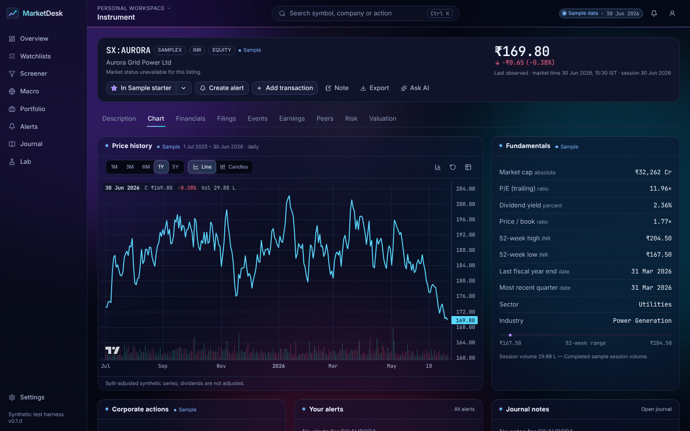

# MarketDesk

A personal market research terminal for Indian equities, built on **real market data** from Yahoo Finance:
watchlists, instrument charts and fundamentals, an INR portfolio ledger with CSV import/export, sampled price
alerts, an investment journal and a rule-based morning briefing. It runs as a FastAPI web process (API + built React
SPA on the same origin) plus one alert worker, on SQLite.

It is a research and record-keeping tool. It does not place orders, connect to a broker, or make recommendations.
No paid or LLM APIs are used.


| Instrument detail | Phone |
| --- | --- |
|  |  |

Screenshots were captured on 3 Nov 2026 from Yahoo Finance via yfinance; the prices shown are from that moment.
The portfolio starts empty: MarketDesk never invents holdings.

## Real data only

The app shows Yahoo Finance data through the unofficial [yfinance](https://ranaroussi.github.io/yfinance/) library
(1.7.0). Every value carries its source, market time, fetch time, currency, timezone and a freshness status
(`available`, `cached`, `stale`, `missing`, `unsupported`, `unavailable`). Missing data is shown as an explained em
dash, never as zero. When Yahoo fails, the last successful result is shown marked **stale**, and alerts are not
evaluated on it. Market open/closed status is shown as unavailable because no verified NSE holiday calendar is
bundled.

The repository also contains a deterministic synthetic dataset (`fixtures/`, `DATA_PROVIDER=fixture`). It exists only
so the automated tests and CI are reproducible without the internet. The server **refuses to start with it in
production**, and it never appears in a deployed site.

**Data rights.** yfinance is not affiliated with Yahoo. Yahoo data is intended for personal use; read the yfinance
documentation and Yahoo's terms before redistributing anything. Keep your instance private (owner login is mandatory
in production). Note that Yahoo rate-limits some cloud IP ranges; MarketDesk then shows stale/unavailable states
rather than wrong numbers.

## Deploy

The host must run a long-lived web process **and** the alert worker, with a **persistent disk** for SQLite. Static
hosts cannot run the backend, and sleeping or free tiers cannot evaluate alerts continuously. Every route below needs
three secrets:

- `OWNER_USERNAME` — your login name.
- `OWNER_PASSWORD_HASH` — an argon2 hash, created with the command below; you type the password, it is never stored.
- `SESSION_SECRET` — 32+ random characters (`python3 -c "import secrets; print(secrets.token_urlsafe(48))"`).

From a checkout of this repository:

```bash
cd apps/api && uv sync && uv run marketdesk hash-password
```

or with plain Python 3 (prompts for the password without echoing it):

```bash
python3 -m pip install argon2-cffi==25.1.0 && python3 -c "import getpass; from argon2 import PasswordHasher; print(PasswordHasher().hash(getpass.getpass('Owner password: ')))"
```

### Option A — Render (deploys from this GitHub repository)

`render.yaml` defines one Docker web service in Singapore that runs web + worker together
(`python -m marketdesk.serve`) with a 1 GB persistent disk at `/data`. Render disks need a paid instance and attach
to a single instance, which is why both processes share one container (measured: about 315 MB together).

1. Render dashboard → **New** → **Blueprint** → connect this repository (branch `main`).
2. Enter `OWNER_USERNAME` and `OWNER_PASSWORD_HASH` when prompted. Paste the hash exactly as printed, starting with
   `$argon2id$`, **without** quotes (quotes are only needed in a Compose `.env` file). `SESSION_SECRET` is generated.
3. Apply. The first build takes a few minutes. Render serves HTTPS at `https://<service>.onrender.com`; the health
   check is `/api/health`. Sign in, then use **Load NSE starter** or add symbols with Ctrl/Cmd+K.
4. Check **Settings → Data status**: provider Yahoo, alert worker running. If Yahoo rate-limits Render's IPs, panels
   show stale/unavailable states with the reason.

`render.yaml` was validated against Render's published blueprint schema (`https://render.com/schema/render.yaml.json`).

With a disk attached Render stops the old instance before starting the new one, so each deploy has a few seconds of
downtime.

### Option B — Any Linux server with Docker Compose

```bash
git clone https://github.com/its-harsh-here/MarketDesk.git && cd MarketDesk && cp .env.example .env
```
```bash
docker compose build && docker compose run --rm --no-deps web python -m marketdesk.cli hash-password
```

Put the hash in `.env` as `OWNER_PASSWORD_HASH='…'` (keep the single quotes), set `OWNER_USERNAME` and
`SESSION_SECRET`, then:

```bash
docker compose up -d
```

`migrate` runs once and exits; `web` (127.0.0.1:8000) and `worker` start with health checks. Put HTTPS in front, for
example with Caddy (`desk.example.com { reverse_proxy 127.0.0.1:8000 }`). Cookies are `Secure` in production.

If Docker Hub rate-limits pulls, set `PYTHON_IMAGE=mirror.gcr.io/library/python:3.13-slim` and
`NODE_IMAGE=mirror.gcr.io/library/node:22-slim` in `.env`. Behind a TLS-intercepting proxy, build with
`docker build --secret id=ca_bundle,src=/path/to/ca.crt .`.

### Container notes

- The image's entrypoint makes `/data` writable (platform disks are mounted root-owned) and drops to the unprivileged
  `marketdesk` user; no MarketDesk process runs as root. CLI commands run through `docker compose exec` also switch
  to that user automatically.
- Default command: web only (Compose). `python -m marketdesk.serve`: validate settings, migrate, then supervise web +
  worker in one container (Render, Fly.io, a single VM). It listens on `$PORT`.
- Production refuses to start if credentials or the session secret are missing, or if `DATA_PROVIDER=fixture`.

### Operations

| Task | Command (Compose; on Render use the service Shell without `docker compose exec web`) |
| --- | --- |
| Back up (consistent, online; includes WAL) | `docker compose exec web python -m marketdesk.cli backup /data/backups/md-$(date +%F).db` |
| Restore (stop services first) | `docker compose stop web worker` then `docker compose run --rm --no-deps web python -m marketdesk.cli restore /data/backups/FILE.db --yes` then `docker compose start web worker` |
| Rotate the owner password | generate a new hash, update the secret, restart |
| Sign out every session | rotate `SESSION_SECRET`, or `python -m marketdesk.cli revoke-sessions` |
| Worker health | `python -m marketdesk.cli worker-health` |

Backups use SQLite's backup API, so they are consistent while the app runs. Never copy a live `.db` file without its
`-wal` file. A restore brings back watchlists, transactions, alerts, journal notes and settings.

## Local development

Requirements: Python 3.13 with [uv](https://docs.astral.sh/uv/) 0.11, Node.js 22, internet access to Yahoo.

```bash
cd apps/api && uv sync && uv run marketdesk migrate
```
```bash
cd apps/api && DEV_AUTH_BYPASS=true uv run uvicorn marketdesk.main:app --reload --port 8000
```
```bash
cd apps/api && DEV_AUTH_BYPASS=true ALERT_POLL_SECONDS=60 uv run python -m marketdesk.worker
```
```bash
cd apps/web && npm ci && npm run dev
```

Open http://localhost:5173. `DEV_AUTH_BYPASS` skips login and is refused unless `MARKETDESK_ENV=development` (the
default outside Docker). **Load NSE starter** adds the real NSE symbols listed in
`config/starter_watchlist.yahoo.json`; prices are fetched live.

## Accounting rules

The INR ledger supports DEPOSIT, WITHDRAWAL, BUY, SELL, DIVIDEND and explicitly confirmed SPLIT, long-only.
Decimal arithmetic throughout; amounts settle to paise; average cost keeps full precision and is rounded only for
display. Buy cost = qty × price + fees; a sell releases qty × average cost; realized P&L = proceeds − fees − released
basis; splits change quantity, not basis. Every edit replays the whole ledger and is rejected if cash would go
negative or a sale would exceed holdings at any point. Average cost is an analytical convention, not a tax report.
Net deposits are not shown as gains, and returns (XIRR/TWR) are deliberately not computed in this release.

CSV import uses the canonical columns `date,type,symbol,quantity,price,fees,amount,currency,split_from,split_to,notes`
(a template is downloadable in the import dialog). Imports are previewed row by row, all-or-nothing, and duplicate rows
are skipped. Exports neutralise spreadsheet formulas.

## Alerts

Alerts are **sampled**: the worker polls quotes every `ALERT_POLL_SECONDS` (default 300) and fires once on the first
observed match, then waits to be rearmed. Observations are keyed by market timestamp and events by `alert:arm`, so
cached re-reads and worker restarts cannot duplicate events. Stale or failed quotes are never evaluated. Only in-app
notifications exist. Alerts require the server and worker to be running.

## Tests

Automated tests use the synthetic harness so they are deterministic and never depend on Yahoo being up.

| Suite | Command |
| --- | --- |
| API (pytest) and lint | `cd apps/api && uv run pytest && uv run ruff check marketdesk tests` |
| Web types, lint, unit, build | `cd apps/web && npx tsc -b --noEmit && npx eslint . && npx vitest run && npm run build` |
| Browser journeys (real API + worker) | after building the web app: `cd tests/e2e && npm ci && npx playwright test` |
| Visual QA captures (not committed) | `cd tests/e2e && npm run screenshots` → `tests/e2e/test-results/screenshots` |
| Live Yahoo smoke test | `cd apps/api && uv run python ../../scripts/check_yahoo.py` |

CI (`.github/workflows/ci.yml`) runs these suites and builds the Docker image. Results are recorded in
`docs/STATUS.md`. API types for the frontend are generated from OpenAPI: `cd apps/web && npm run gen:api`.

## Layout

```
apps/api     FastAPI app (marketdesk/), Alembic migrations, pytest suite
apps/web     React + TypeScript SPA (src/app, components, features, lib, styles), Vitest
tests/e2e    Playwright journeys and visual QA captures
fixtures     Synthetic test-harness dataset (tests only; refused in production)
config       Starter NSE watchlist and benchmark indices
docs         PLAN, STATUS, DECISIONS, screenshots
```

## Runtime versions

Python 3.13 · FastAPI 0.162.0 · Uvicorn 0.54.0 · SQLAlchemy 2.1.6 · Alembic 1.20.1 · Pydantic 2.14.2 · yfinance 1.7.0 ·
pandas 3.1.0 · argon2-cffi 25.1.0 · Node 22 · React 19.3.1 · Vite 7.3.7 · TypeScript 5.9.3 · Tailwind CSS 4.3.4 ·
TanStack Query 5.105.3 · React Router 7.18.5 · React Hook Form 7.91.0 · Zod 4.6.7 · Lightweight Charts 5.2.1 ·
Vitest 3.2.7 · Playwright 1.63.0. Exact pins are in `apps/api/uv.lock` and the `package-lock.json` files.

## Attribution

- Charts: [TradingView Lightweight Charts™](https://www.tradingview.com/lightweight-charts/) (Apache-2.0), Copyright ©
  TradingView, Inc. Each chart shows the TradingView attribution logo; Settings → About repeats it.
- Market data: Yahoo Finance via [yfinance](https://github.com/ranaroussi/yfinance) (Apache-2.0, unofficial).
- Fonts: Inter and JetBrains Mono (SIL OFL 1.1) bundled through Fontsource. Icons: Lucide (ISC).

No licence has been chosen for MarketDesk's own code; add one before distributing it.

## Known limitations

See `docs/STATUS.md`. In short: alerts are sampled, not tick-by-tick; market open/closed status is not shown;
portfolio is INR-only and long-only; no XIRR/TWR or historical equity chart; Yahoo coverage and field availability
vary (fields are shown as missing rather than guessed), and Yahoo may rate-limit cloud hosts.
